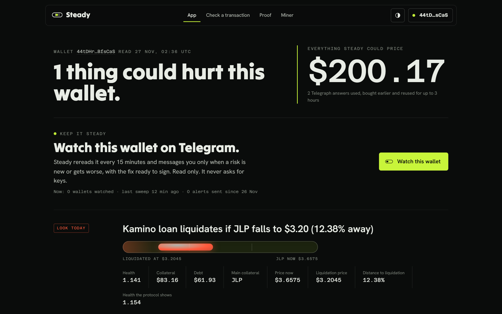

<p align="center"></p>

<h1 align="center">Steady</h1>

<p align="center"><b>Know what could hurt your Solana wallet. Then fix it.</b><br>
Steady reads everything a wallet holds from mainnet, buys the facts the chain cannot know from Telegraph miners, and hands you the exact transaction to sign in Phantom.</p>

<p align="center">
<a href="https://steady.jdollar.site">Live app</a> ·
<a href="https://steady.jdollar.site/proof">Proof</a> ·
<a href="https://t.me/steadysol_bot">Telegram watcher</a> ·
<a href="https://steady.jdollar.site/miner">Telegraph miner 6203</a> ·
<a href="docs/evaluator.md">Evaluation material</a>
</p>

<p align="center">


</p>

<p align="center"></p>

On Oct 10 2025 about $19B of leveraged positions were wiped out in hours, $1.7B of it long SOL. Most of those people could see their health number. Nobody told them what to do about it, and nobody watched it for them.

## Judges: start here

| Path | What you see | Sign in | Time |
|---|---|---|---|
| [Open the sample wallet](https://steady.jdollar.site/app?wallet=44tDHrCk3yr91ruoGk9VZMHJoKDjviuHAXZrwYBfsCaS) | A real Kamino JLP loan about 12% from liquidation, the Telegraph answers bought for it, and **Prepare fix**: a repay with collateral built and simulated on mainnet | none | 1 min |
| [Paste your own wallet](https://steady.jdollar.site/app) | The same read on any Solana address | none | 1 min |
| [Check a transaction](https://steady.jdollar.site/check) | Steady simulates a transaction before you sign and blocks takeovers, hidden approvals and lookalike addresses | none | 1 min |
| [Proof](https://steady.jdollar.site/proof) | The forward prediction ledger against a blind frontier model, signed calls that settle from chain reads | none | 2 min |
| [Miner](https://steady.jdollar.site/miner) | Steady's own Telegraph miner answering pool depth from the vaults | none | 1 min |
| [@steadysol_bot](https://t.me/steadysol_bot) | Watches a wallet every 15 minutes and sends the fix when something crosses a line | Telegram | 2 min |

## What it does

1. **Reads the whole wallet from mainnet.** Tokens, staked SOL and LSTs, loans on Kamino, marginfi and Save, LP on Orca, Raydium and Meteora, perps on Drift and Jupiter. Every loan shows Steady's own health next to the number the protocol reports, so you can see they agree.
2. **Buys what the chain cannot know.** News about each protocol the wallet uses, sanctions screening for recipients, and supply rates, paid per answer through Telegraph with x402. Code judges every answer, and the ones that do not hold up are shown struck out with the reason.
3. **Builds the fix.** For the sample loan, Steady uses Kamino's SDK to flash borrow, repay the USDT, withdraw JLP and swap it back in one transaction, so no spare tokens are needed. It runs on mainnet first without sending, then Phantom asks you to approve.
4. **Checks before you sign.** Paste or build a transaction and Steady simulates it against your real accounts. It blocks any change of owner or authority over your wallet, token or stake accounts, flags large outflows to addresses that are not in your history, and screens recipients.
5. **Signs every recommendation.** Each result is an EIP-191 signed memo over the exact numbers, sources and Telegraph receipts. `POST /verify` recomputes it. A fix memo is only signed when the fix came from Steady's own signed advice for that wallet.
6. **Keeps watching.** The Telegram bot sweeps watched wallets every 15 minutes and sends the alert with the fix ready.

## Telegraph integration

| What | Where |
|---|---|
| Paid asks over x402 (Base Sepolia test USDC, $0.05 cap per answer, daily cap that resets at 00:00 UTC) | [src/telegraph/client.ts](src/telegraph/client.ts) |
| `NEWS_SEARCH_GENERAL` per protocol held, judged by code | [src/engine/advice/advise.ts](src/engine/advice/advise.ts) |
| `CRYPTO_YIELD_RATE_GENERAL` checked against the public rate | [src/engine/advice/advise.ts](src/engine/advice/advise.ts) |
| `SANCTIONS_SCREENING_MATCH_GENERAL` for recipients before signing | [src/presign/check.ts](src/presign/check.ts) |
| Receipt hash, signal hash and cost kept in every memo | [src/memo/memo.ts](src/memo/memo.ts) |
| Miner for `LIQUIDITY_DEPTH_VERIFY_GENERAL`, registration 6203, active | [src/miner/](src/miner/), [miner/steady-liquidity.yaml](miner/steady-liquidity.yaml) |
| 21 signed evaluation rows for three Solana intents, all admitted | [docs/evaluator.md](docs/evaluator.md), [scripts/evalpool-make.ts](scripts/evalpool-make.ts) |

**Missions:** Web3 Native and DeFi, Personal Agent, Asset Management.

**Network:** Solana mainnet for every read and simulation. Telegraph payments on Base Sepolia (test USDC); miner and evaluation material on the Telegraph testnet node (Ethereum Sepolia registry). Steady never holds keys for your wallet and never sends a transaction for you.

## Measured, not guessed

| Claim | How it is checked |
|---|---|
| Loan health matches the protocol | Kamino and marginfi readers compared with each protocol's own numbers, recorded fixtures in [src/engine/__fixtures__](src/engine/__fixtures__) |
| A single miner answer is not safe to act on | A paid miner answered $3,500,000 for Orca SOL/USDC (`Czfq3x…u44zE`) on Nov 25 2026. The vaults hold about $18,000,000. Steady's own miner reads the vaults. |
| Calls are made before the outcome | 23 signed predictions made Nov 26 2026 09:41 UTC, settling Nov 27 and Nov 29 from chain reads, each next to a blind frontier model answer ([/proof](https://steady.jdollar.site/proof), `GET /ledger`) |
| Fixes would land | Every prepared transaction is simulated on mainnet before you see it |
| Takeovers are caught | Unit tests on real instruction bytes ([src/presign/check.test.ts](src/presign/check.test.ts)) and a live probe ([scripts/probe-audit.ts](scripts/probe-audit.ts)) |

## Run it

Requires Node 22+, a Helius key, and an EVM key holding a little Base Sepolia test USDC for Telegraph answers.

```bash
git clone https://github.com/jenzylove/steady && cd steady
npm install          # on Windows add --force (one optional dependency is Linux only)
cp .env.example .env # fill HELIUS_API_KEY, TELEGRAPH_PAYER_KEY, MEMO_SIGNER_KEY
npm test             # 84 tests, live tests skipped
npm run api          # http://localhost:8788
```

Try it:

```bash
# Read a wallet, buy the Telegraph checks, get a signed memo (about 30 s, about $0.02 in test USDC)
curl -s -X POST localhost:8788/advise -H 'content-type: application/json' \
  -d '{"wallet":"44tDHrCk3yr91ruoGk9VZMHJoKDjviuHAXZrwYBfsCaS"}'

# Expected: findings[0] is "kamino loan liquidates if JLP falls to …" with a fix of action "repay"

# Check the live API rejects a wallet takeover and a forged fix memo
npx tsx scripts/probe-audit.ts http://localhost:8788
```

Error cases: a non Solana address returns 400; more than the free daily runs returns 429; a pool the miner does not support returns 400 `unsupported_pool`; a chain other than Solana returns 400 `unsupported_chain`.

The web app is in [web/](web/) (`cd web && npm install && npm run dev`, set `NEXT_PUBLIC_API_URL`). The miner runs with `npm run miner`, the bot with `npm run bot`.

## For builders

- **Use the miner from your app:** ask Telegraph for `LIQUIDITY_DEPTH_VERIFY_GENERAL` with `{"pool": "Orca SOL/USDC", "chain": "solana"}`, or call it directly: `curl "https://steady-miner-production.up.railway.app/liquidity?pool=Orca%20SOL/USDC&chain=solana"`.
- **Check a transaction before your users sign it:** `POST /presign` with `{wallet, transaction}` (base64) returns `ok`, `caution` or `block` with reasons.
- **Add evaluation material for Solana intents:** [docs/evaluator.md](docs/evaluator.md) shows how the rows are made from chain reads and signed for the pool.

## Commercial summary

**Who is it for?** Anyone holding real money on Solana in more than a plain wallet: borrowers on Kamino, marginfi and Save, LPs, perp traders. A borrower near liquidation faces this every volatile day.

**What does it improve?** Today a borrower sees a health number on each protocol's own dashboard and has to work out the fix alone. Steady reads every protocol at once, explains the risk in plain words, and prepares the transaction that fixes it, simulated before you see it.

**What does it do today?** Everything above is live on mainnet reads. Telegraph answers cost about $0.01 each in test USDC, with one to three per wallet check; a full check takes about 30 seconds.

**Why would someone adopt it?** Because it saves the position, not just reports it. Before production: real USDC payments on Telegraph mainnet, deposit builders for marginfi and Save, and a paid plan for continuous watching.

**How can someone try it?** Open the sample wallet or paste your own at [steady.jdollar.site](https://steady.jdollar.site), or start [@steadysol_bot](https://t.me/steadysol_bot). Maintained by [@jenzylove](https://github.com/jenzylove).

## Security

See [SECURITY.md](SECURITY.md). Built with AI coding assistance.

## License

MIT
